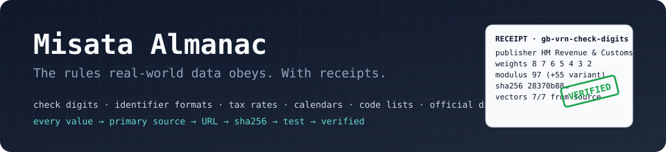
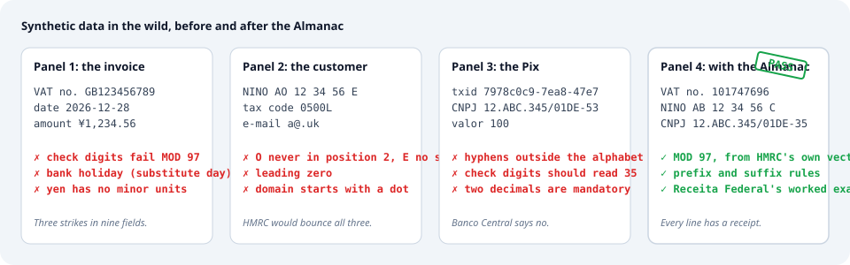
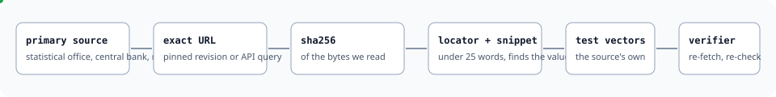

<p align="center">
  
</p>

# Misata Almanac

**The open rulebook for synthetic data that survives contact with reality.**

Check-digit algorithms, identifier formats, tax rates, bank holidays, currency
minor units, code lists, and distributions from official statistics. Every
value traced to the statistical office, central bank, regulator or standards
body that published it, with the exact URL, the SHA-256 of what was fetched,
and the tests that prove it still holds. The [Misata](https://pypi.org/project/misata/)
synthetic data engine reads this archive so the data it generates passes the
same validators, reconciliations and sanity checks that real data passes.

Created and edited by Muhammed Rasin.

<p align="center">
  
</p>

## Why this exists

Most generated data is wrong in ways that only show up later. A VAT number
whose check digits do not add up. A payment dated on a bank holiday. A yen
amount with two decimals. A tax code with a leading zero. A Pix transaction id
with hyphens in it. Each one is small; together they are why synthetic data
gets thrown out the moment it meets a real system.

The fix is not cleverness. It is knowing the rules, knowing where they come
from, and being able to prove it. That is what an almanac is for.

<p align="center">
  
</p>

## What you get

| | |
| --- | --- |
| **Rules you can run** | Modulus checks, formats, calendars and rate schedules implemented in typed Python, with test vectors taken from the publisher's own examples. |
| **Distributions you can sample** | Census marginals, population weights, payment key mixes, FX and policy-rate series, each with the published counts beside the derived shares. |
| **Proof you can re-run** | `almanac verify` re-fetches every source, checks the hash, finds the snippet and the value, runs every vector, and reproduces every statistic. |
| **Time you can ask about** | Every entry says when it applied. `almanac applies --on 2026-06-15` answers for any date. |
| **Indexes for machines** | `manifest.json`, `dataset.jsonld` (schema.org) and `llms.txt` so search engines, data catalogues and AI agents find the right entry without reading YAML. |

## Thirty seconds

```
uv sync
uv run almanac verify                      # re-fetch and re-check every entry
uv run almanac applies --on 2026-06-15     # which entries applied on that date
uv run almanac show gb-utr-check-digit     # the provenance card for one entry
```

```python
from datetime import date
from almanac.api import Almanac

almanac = Almanac.load()

almanac.rule("gb-utr-check-digit").call("check_digit", "234567890")        # '2'
almanac.rule("br-cnpj-check-digits").call("check_digits", "12.ABC.345/01DE") # '35'
almanac.rule("global-iso4217-currency-minor-units").call("minor_units", "JPY") # 0
almanac.rule("gb-bank-holidays").call("is_bank_holiday", date(2026, 12, 28), division="england-and-wales")  # True
almanac.rule("gb-income-tax-bands-2026-27").call("tax_due", 35000)                    # Decimal('4486.00')
almanac.rule("br-selic-target-rate-changes-2025").call("value_on", date(2025, 7, 1))  # 15.0

for entry in almanac.select(on=date(2026, 6, 15), region="GB", kind="rule"):
    print(entry.id, entry.tier, entry.status)
```

## Start from the business problem

Every entry carries `use_cases`, so you can pull exactly what a demo or a
test suite needs:

```
uv run almanac list --use-case payroll-demo
uv run almanac list --use-case kyb-onboarding
uv run almanac applies --on 2026-06-15 --use-case banking-demo
```

| If you are building… | Start with |
| --- | --- |
| **Payroll and HR** demos | UK income tax bands with the tapered allowance, minimum wage by age band and date, NINO and tax code formats, Census economic activity and qualifications |
| **Banking, lending and treasury** demos | Selic and ECB deposit-rate step schedules, policy rates for nine economies, euro area mortgage cost of borrowing, Brazil household credit default rate, financial account ownership by economy |
| **Payments and fintech** demos | Pix identifier formats, monthly Pix volume and average ticket, Pix key-type mix, HMRC payment reference check characters, bank holidays for settlement calendars |
| **KYC, KYB and onboarding** flows | CNPJ and UTR check digits, VAT registration numbers, Companies House company types and statuses, SIC 2007 codes, email acceptance rules, World Bank economy classification |
| **Invoicing, tax and audit** demos | UK VAT rates, India GST slab structure, ISO 4217 minor units, ECB and US Treasury exchange-rate tables, CPIH and IPCA price indices |
| **Customer, person and household** generation | Twelve Census 2021 marginals, world population weights, female population share, urban share, fertility and life expectancy by economy |
| **Retail and demand** demos | Retail sales index with its December peak, inflation series, GDP and GDP per capita by economy |
| **Telecom and digital** demos | Internet users and mobile subscriptions per 100 people by economy, clock-change dates for timestamps |

The full matrix of use cases to entries is the first table in
[CATALOGUE.md](CATALOGUE.md).

## What is in the archive

See [CATALOGUE.md](CATALOGUE.md) for the generated tables. By domain:

- **Identifiers**: UK National Insurance numbers, Unique Taxpayer References,
  VAT registration numbers and PAYE, SDLT and other-tax payment references
  from HM Revenue & Customs' own validation library; Brazil CNPJ check digits
  from Receita Federal's worked example.
- **Payments**: Brazil Pix identifier formats from the Banco Central do Brasil
  API specification, monthly Pix volume, value and average ticket, and the mix
  of Pix key types registered in the DICT.
- **Currency**: ISO 4217 codes with numeric codes and minor units from the
  maintenance agency's list; ECB euro reference rates, monthly 2025, for seven
  currencies; US Treasury reporting rates of exchange for 174 currency pairs.
- **Tax and employment**: UK VAT rates with the 2011 effective date, UK Income
  Tax bands and the tapered Personal Allowance for 2026 to 2027, National
  Minimum Wage rates by age band for April 2026 and April 2027, UK PAYE tax
  code format, and the India GST slab structure after the 56th GST Council
  meeting.
- **Economy and rates**: thirteen World Bank reference tables by economy (GDP,
  GDP per capita, inflation, unemployment, labour participation, internet use,
  mobile subscriptions, urban share, life expectancy, fertility, female share,
  account ownership, and the region and income-group classification); euro
  area HICP inflation and mortgage cost of borrowing; ECB deposit facility
  rate changes; Brazil Selic target changes, IPCA inflation and household
  credit default rate; UK CPIH index and retail sales index, all monthly 2025.
- **Calendar**: UK bank holidays by nation, 2019 to 2028, and the clock-change
  rule with its published dates.
- **Demographics**: twelve Census 2021 marginals for England and Wales (sex,
  single year of age, ethnic group, religion, marital status, economic
  activity, general health, highest qualification, household size, tenure, car
  availability, accommodation type) and world population weights by economy.
- **Rates**: central bank policy rates for nine economies, monthly 2025.
- **Company and contact**: Companies House company type and status codes, the
  SIC 2007 condensed code list, and the email address pattern HMRC services
  accept.

Entries whose source terms are not clearly permissive stay at
`license-review` and say so. [WANTED.md](WANTED.md) lists what we want next,
each with the official body to source it from.

## Anatomy of an entry

```yaml
id: gb-vrn-check-digits
kind: rule
region: GB
status: verified
tier: A
valid_from: 2025-08-11
valid_to: null
spec:
  implementation: almanac.rules.gb_vrn
  parameters: {length: 9, weights: [8, 7, 6, 5, 4, 3, 2], modulus: 97, variant_offset: 55}
  vectors:
    - {input: "101747696", expected: true, origin: source}
evidence:
  - publisher: HM Revenue & Customs
    url: https://raw.githubusercontent.com/hmrc/domain/bc4a37fe.../ReferenceChecker.scala
    locator: "lines 123-127, VatReferenceChecker"
    value: "List(8, 7, 6, 5, 4, 3, 2)"
    snippet: "object VatReferenceChecker extends DifferenceReferenceChecker"
    source_license: Apache-2.0
    content_sha256: 28370b88…
assumed: []
tests:
  - {statistic: vector_pass_fraction, expected: 1, tolerance: 0}
```

`spec` is what a data engine executes. `evidence` is why you should believe
it; an item marked `role: supporting` documents context such as units or
licence terms. `assumed` is where anything restated, converted, fitted or
guessed is confessed, with the method. `tests` is what the verifier
reproduces.

## Evidence tiers

| Tier | Meaning |
| --- | --- |
| A | Reproducible from an official machine-readable artefact (API response, CSV, XLSX, SDMX, JSON, YAML, or source code published by the body) at an exact URL, with the content hash recorded. |
| B | A value located in an official document (PDF or HTML) with publisher, title, page, table or cell locator, and a short snippet. |
| C | An estimate or derived value without direct official publication. Allowed only when clearly labelled and accompanied by `assumed[]`; omission is preferred. |

## Entry kinds and temporal validity

- **rule**: deterministic and executable: check digits, numbering formats,
  code lists, calendars, rate schedules. Carries `valid_from` and `valid_to`.
- **marginal**: a distribution or category shares for one variable. Carries
  `observed_period`.
- **temporal**: a time series, seasonality or trend from an official source.
  Carries `observed_period`.
- **conditional**: a distribution conditioned on another variable, only when
  the source publishes it directly. Carries `observed_period`.

For a rule, `valid_from` is the earliest date the cited evidence attests the
rule, unless the source states an effective date. It is a statement about the
proof, not a claim about legislative history.

## Integrity rules

1. Never write a number, rate, rule or date from memory.
2. Primary sources only: national statistical offices; central banks;
   ministries, regulators and gazettes; intergovernmental bodies; official
   operators of payment and numbering systems; peer-reviewed open-access
   papers.
3. Record each source's licence; unclear terms keep an entry at
   `license-review`, never `verified`.
4. At most one verbatim snippet under 25 words per evidence item, used only
   to locate the value. Never copy tables or passages.
5. Keep observation apart from assumption: anything fitted, derived or
   assumed goes in `assumed[]` with the method stated.

The verifier enforces what it can: schema and typed models, directory
placement, dates, units, snippet length, hash and content checks against the
live source (PDFs by extracted text), machine-readable primary evidence for
tier A, permissive licences for `verified` entries, every rule vector, and
every published statistic.

## Layout

```
schema/entry.schema.json      JSON Schema every entry must satisfy
entries/<domain>/<region>/    one YAML file per entry; region is ISO 3166-1 alpha-2 or "global"
almanac/                      Python package: models, api, rules, fetcher, verifier, CLI
almanac/rules/                executable rule implementations
tools/                        reproducible builders for generated entries
tests/                        pytest suites for the verifier, the API and the rules
CATALOGUE.md                  generated table of entries
manifest.json                 generated JSON index of every entry
dataset.jsonld                generated schema.org Dataset description
llms.txt                      generated map of the archive for AI agents
WANTED.md                     entries we want next, with their official sources
```

## Verify locally

Requires [uv](https://docs.astral.sh/uv/) and Python 3.13. There is no CI;
everything runs on your machine, which is the point.

```
uv sync
uv run almanac verify                                     # all entries, live re-fetch
uv run almanac verify entries/identifiers/GB              # one directory or file
uv run almanac verify --cache-dir .cache/evidence         # keep fetched copies
uv run almanac verify --cache-dir .cache/evidence --offline
uv run almanac verify --no-fetch                          # structure, vectors and statistics only
uv run almanac verify -v --json                           # machine-readable report
uv run almanac catalogue --write CATALOGUE.md             # refresh the catalogue
uv run almanac index                                      # refresh manifest.json, dataset.jsonld, llms.txt
uv run pytest
```

## Licences

- **Entries** (`entries/`, `schema/`, the generated catalogue and indexes)
  are data, released under the Open Database License 1.0 in `LICENSE-DATA`.
  Share, create and adapt the database; attribute it; keep derived databases
  open.
- **Code** (`almanac/`, `tools/`, `tests/`) is released under the Apache
  License 2.0 in `LICENSE`.

Each evidence item also records the licence of its own source; that licence
governs the source material, not this repository's restatement of it.

## Citing

See `CITATION.cff`. In prose: Muhammed Rasin, *Misata Almanac*, Misata Labs,
https://github.com/Misata-labs/almanac.
