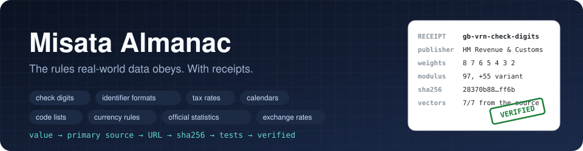
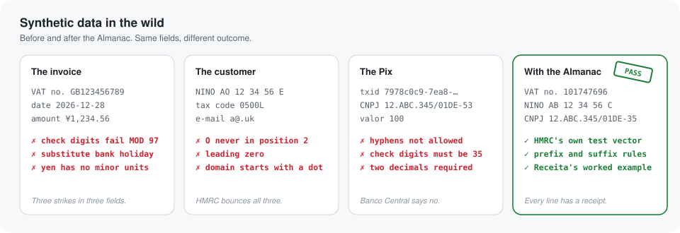
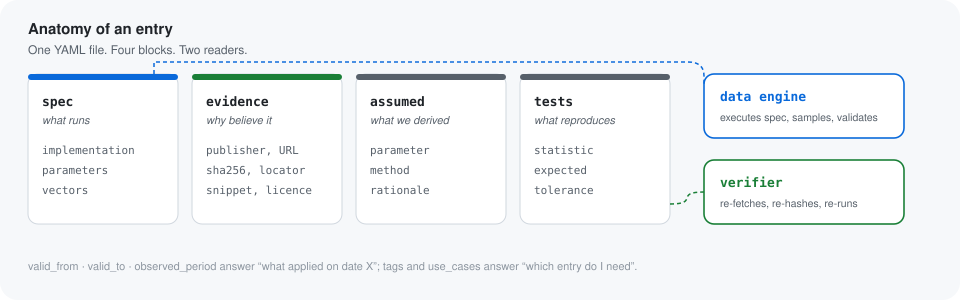
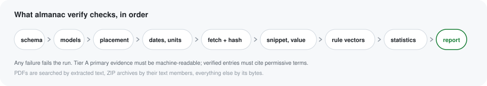

<p align="center">
  <picture>
    <source media="(prefers-color-scheme: dark)" srcset="docs/assets/hero-dark.svg">
    
  </picture>
</p>

# Misata Almanac

### Synthetic data rules for realistic synthetic data. Every rule has a receipt.

Check-digit algorithms, identifier formats, tax rates, bank holidays, currency
conventions, industry code lists and official statistics, collected in one
place and traced back to the government body, central bank, regulator or
standards agency that published them. The reference layer for synthetic data
generation, privacy-safe test data, demo environments and data validation,
read by the [Misata](https://pypi.org/project/misata/) synthetic data engine.

Created and edited by Muhammed Rasin · [Misata Studio](https://www.misata.studio) · [misata on PyPI](https://pypi.org/project/misata/)

---

## Why realistic synthetic data needs a rulebook

Synthetic data is only as useful as its fidelity. A generated VAT number
whose check digits do not add up, an invoice dated on a bank holiday, a yen
amount with two decimals, a tax code with a leading zero, a Pix transaction id
with hyphens in it: each is a small departure from how real records behave,
and each one stops a dataset at the first validator, reconciliation job or
review it meets. Teams building synthetic data for product demos, QA
environments, analytics prototypes and machine learning need records that
follow the same rules as production data, without touching production data.

Fidelity is not a matter of cleverer generators. It comes from knowing the
rules, knowing where they come from, and being able to prove it. That is what
an almanac is for.

<p align="center">
  <picture>
    <source media="(prefers-color-scheme: dark)" srcset="docs/assets/before-after-dark.svg">
    
  </picture>
</p>

## What makes this different

Much of the reference data that synthetic data tools rely on is second-hand:
copied from a blog, a wiki, or someone's memory. Nothing here was typed from
memory.

- **Primary sources only.** HM Revenue & Customs, Banco Central do Brasil,
  the European Central Bank, Eurostat, the Office for National Statistics,
  the World Bank, the US Code of Federal Regulations, the CDC, Receita
  Federal, the ITU, the ISO 4217 maintenance agency. If a body did not
  publish it, it is not in here.
- **Receipts, not citations.** Every value records the exact URL it was
  fetched from, the SHA-256 of the bytes, where in the resource it sits, and
  a snippet that finds it. A citation says "trust me". A receipt says "check".
- **Executable, not descriptive.** Rules ship as typed Python with the
  publisher's own worked examples as test vectors. Distributions ship with the
  published counts beside the derived shares, and the verifier reproduces
  them by sampling.
- **Dated.** Every entry says when it applied. Ask the archive what the world
  looked like on any given day.
- **Re-verifiable by anyone.** One command re-fetches every source and fails
  loudly if anything drifted. There is no CI because you should not have to
  trust ours.

<p align="center">
  <picture>
    <source media="(prefers-color-scheme: dark)" srcset="docs/assets/proof-chain-dark.svg">
    
  </picture>
</p>

## Start from the problem you are solving

Every entry is tagged with the business scenario it serves, so a demo team or
a test engineer pulls exactly what the story needs.

```
uv run almanac list --use-case payroll-demo
uv run almanac list --use-case kyb-onboarding
uv run almanac applies --on 2026-06-15 --use-case banking-demo
```

| You are building… | Reach for |
| --- | --- |
| **A payroll or HR demo** | UK Income Tax bands with the tapered Personal Allowance, National Minimum Wage by age band and date, National Insurance number and tax code formats, Census economic activity and qualifications |
| **A banking, lending or treasury demo** | Selic and ECB deposit-rate step schedules, policy rates for nine economies, euro area mortgage cost of borrowing, Brazil household credit default rate, financial account ownership by economy |
| **A payments or fintech demo** | Pix identifier formats, monthly Pix volume and average ticket, Pix key-type mix, HMRC payment reference check characters, bank holidays for settlement calendars |
| **KYC, KYB or customer onboarding test data** | CNPJ and UTR check digits, VAT registration number validation, Companies House company types and statuses, SIC 2007 codes, the email pattern HMRC accepts, World Bank economy classification |
| **Invoicing, tax or audit test data** | UK VAT rates, India GST slab structure, ISO 4217 minor units, ECB and US Treasury exchange-rate tables, CPIH and IPCA price indices |
| **Synthetic customers, people and households** | Twelve Census 2021 marginals for England and Wales, single-year age distributions for Germany and France, world population weights, fertility and life expectancy by economy |
| **Healthcare and claims test data** | ICD-10-CM 2026 diagnosis categories with code counts, the NPI Luhn check digit, Census general health, life expectancy by economy |
| **Insurance, property or fleet data** | The VIN check digit from the federal regulation, UK house prices by month, euro area mortgage rates, Census tenure and car availability |
| **Retail and demand forecasting demos** | Retail sales index with its December peak, inflation by month and by country, GDP and GDP per capita by economy |
| **Telecom, energy and utilities demos** | ITU country calling codes, internet and mobile penetration by economy, household electricity prices for ten EU states, clock-change dates |
| **Value pools: margins, costs, churn and defaults** | After-tax margins by industry from the Census Quarterly Financial Report, FDIC bank performance ratios and size classes, Fed charge-off and delinquency rates, IRS corporation returns by sector, Eurostat enterprise accounts for ten member states with operating rate and personnel-cost share, enterprise birth, death and survival rates, hourly labour cost by section, UK rate of return and business survival |
| **Behaviour over time** | UK employment, unemployment, vacancies, redundancies and claimant count by month, average weekly earnings, household saving ratio, internet share of retail, energy price cap levels, EU air passengers by month, Indian wireless subscribers and ARPU by quarter |
| **India: telecom, insurance and insolvency demos** | TRAI subscribers by operator and service area, prepaid versus postpaid split, mobile number portability requests, broadband by provider, IRDAI premium by segment and death-claim outcomes, IBBI corporate insolvency status and recoveries by initiator, Income Tax slabs and GST structure |

The complete map of use cases to entries opens [CATALOGUE.md](CATALOGUE.md).

## Thirty seconds to a verified rule

```
uv sync
uv run almanac verify                      # re-fetch and re-check every entry
uv run almanac applies --on 2026-06-15     # which entries applied on that date
uv run almanac show gb-utr-check-digit     # the provenance card for one entry
```

```python
from datetime import date
from almanac.api import Almanac

almanac = Almanac.load()

almanac.rule("gb-utr-check-digit").call("check_digit", "234567890")            # '2'
almanac.rule("br-cnpj-check-digits").call("check_digits", "12.ABC.345/01DE")   # '35'
almanac.rule("us-vin-check-digit").call("check_digit", "1G4AH59H45G118341")    # '4'
almanac.rule("global-iso4217-currency-minor-units").call("minor_units", "JPY") # 0
almanac.rule("gb-income-tax-bands-2026-27").call("tax_due", 35000)             # Decimal('4486.00')
almanac.rule("us-federal-holidays").call("is_holiday", date(2026, 7, 3))       # True, the observed day
almanac.rule("br-selic-target-rate-changes-2025").call("value_on", date(2025, 7, 1))  # 15.0

for entry in almanac.select(on=date(2026, 6, 15), region="GB", kind="rule"):
    print(entry.id, entry.tier, entry.status)
```

## What is inside

Two hundred and forty-one entries across twenty-eight domains and sixteen
regions at the time of writing, every one of them passing live verification. The generated
[CATALOGUE.md](CATALOGUE.md) is the authoritative list; this is the tour.

**Rules from statute and regulation.** US Regulation CC funds-availability
amounts, Regulation E liability limits, Regulation Z thresholds, FCRA time
limits, FLSA salary levels, OSHA and FMLA thresholds, the federal minimum wage
history, Social Security full retirement age, FICA rates, the HIPAA
safe-harbour identifier list, FDA daily values; UK working-time limits and
statutory holiday entitlement; UK Scottish income tax, dividend, capital gains,
corporation, stamp duty and inheritance tax rates; Universal Credit,
Jobseeker's Allowance, disability and child benefit rates; State Pension rates.

**Identifier validation and check digits.** UK National Insurance numbers,
Unique Taxpayer References, VAT registration numbers and the PAYE, SDLT and
other-tax payment references, all from HM Revenue & Customs' own validation
library with its own test suite as vectors. Brazil CNPJ check digits for the
numeric and the new alphanumeric format, from Receita Federal's worked
example. The US vehicle identification number check digit lifted from
49 CFR 565.15 through the eCFR API, with NHTSA's decoder confirming the
vectors. The National Provider Identifier check digit from the CMS note that
defines it.

**Payments and currency.** Pix identifier formats from the Banco Central do
Brasil API specification, monthly Pix volume with the derived average ticket,
and the mix of Pix key types registered in the DICT. ISO 4217 currency codes
with numeric codes and minor units from the maintenance agency's own list.
ECB euro reference rates for seven currencies. US Treasury reporting rates of
exchange for 174 currency pairs.

**Tax, payroll and employment.** UK VAT rates with the 2011 effective date.
UK Income Tax bands and the tapered Personal Allowance for 2026 to 2027.
National Minimum Wage and National Living Wage rates for April 2026 and April
2027. The PAYE tax code format. The India GST slab structure after the 56th
GST Council meeting.

**Calendars.** UK bank holidays by nation through 2028 from the GOV.UK
endpoint. The British Summer Time clock-change rule with its published dates.
US federal holidays from the statute, the executive order and the regulation,
with the Saturday and Sunday observance rules that payroll and settlement
systems actually apply.

**Economy, rates and prices.** Eighty World Bank reference tables by economy,
from GDP per capita to financial account ownership, health workforce, energy
access, broadband, education and emissions, plus the region and income-group
classification. Euro area HICP inflation and mortgage cost of
borrowing. ECB deposit facility and Selic target rate changes as step
schedules. Central bank policy rates for nine economies. UK CPIH and retail
sales indices. Brazil IPCA inflation and household credit default rate.
Eurostat unemployment and inflation by member state, household electricity
prices across ten states.

**Demographics.** Twelve Census 2021 marginals for England and Wales: sex,
single year of age, ethnic group, religion, marital status, economic activity,
general health, highest qualification, household size, tenure, car
availability, accommodation type. Single-year age distributions for Germany
and France. Population by sex for ten member states. World population weights
for 217 economies.

**Value pools and behaviour.** The numbers a demo most often has to invent
and gets wrong: what a company in a given industry actually earns, what it
pays its people, how often customers default or firms die. After-tax profit
margins by industry from the Census Bureau's Quarterly Financial Report. FDIC
quarterly aggregates and performance ratios, institutions by size class,
charter and state, the largest banks by assets. Federal Reserve charge-off and
delinquency rates by loan type, consumer credit outstanding and consumer loan
rates. IRS corporation returns and receipts by sector, individual returns by
income size. Eurostat enterprise accounts for ten member states by NACE
section and division with gross operating rate, personnel-cost share and
value added per person, enterprise births, deaths, churn and survival, hourly
labour cost and the gender pay gap by section, household consumption
structure, housing-cost burden, e-commerce sales and road freight load
factors. UK business births, deaths and survival by industry and region,
private non-financial corporations' rate of return, household saving ratio,
monthly labour market series and the energy price cap.

**India.** TRAI wireless and wireline subscribers by operator and licensed
service area, prepaid and postpaid split, ARPU and minutes of use by quarter,
porting requests, broadband by provider, pay-DTH by operator. IRDAI registered
insurers, premium by segment, motor premium by insurer and death-claim
settlement outcomes. IBBI corporate insolvency admissions by year and sector,
outcomes and realisation by initiator. Income Tax slabs under both regimes and
the GST rate structure.

**Healthcare, property, telecom, companies.** ICD-10-CM FY2026 diagnosis
categories with code counts from the CDC archive. UK House Price Index by
month from HM Land Registry. ITU-T E.164 country calling codes. Companies
House company types and statuses, the SIC 2007 condensed list, and the email
address pattern HMRC services accept.

Entries whose source terms are not clearly permissive wait at
`license-review` and say exactly why. [WANTED.md](WANTED.md) is the queue of
what comes next, each with the official body to source it from. If you know a
national numbering scheme or a statistical release well, that is where to
start.

## Anatomy of an entry

<p align="center">
  <picture>
    <source media="(prefers-color-scheme: dark)" srcset="docs/assets/anatomy-dark.svg">
    
  </picture>
</p>

```yaml
id: gb-vrn-check-digits
kind: rule
region: GB
status: verified
tier: A
valid_from: 2025-08-11
valid_to: null
tags: [vat, vrn, check-digit, hmrc]
use_cases: [invoicing, kyb-onboarding, accounts-payable, audit-demo]
spec:
  implementation: almanac.rules.gb_vrn
  parameters: {length: 9, weights: [8, 7, 6, 5, 4, 3, 2], modulus: 97, variant_offset: 55}
  vectors:
    - {input: "101747696", expected: true, origin: source}
evidence:
  - publisher: HM Revenue & Customs
    url: https://raw.githubusercontent.com/hmrc/domain/bc4a37fe.../ReferenceChecker.scala
    locator: "lines 123-127, VatReferenceChecker"
    value: "List(8, 7, 6, 5, 4, 3, 2)"
    snippet: "object VatReferenceChecker extends DifferenceReferenceChecker"
    source_license: Apache-2.0
    content_sha256: 28370b88…
assumed: []
tests:
  - {statistic: vector_pass_fraction, expected: 1, tolerance: 0}
```

`spec` is what a data engine executes. `evidence` is why you should believe
it. `assumed` is where anything restated, converted, fitted or guessed is
confessed, with the method. `tests` is what the verifier reproduces.

## What the verifier does

<p align="center">
  <picture>
    <source media="(prefers-color-scheme: dark)" srcset="docs/assets/pipeline-dark.svg">
    
  </picture>
</p>

```
[PASS] gb-utr-check-digit  (entries/identifiers/GB/gb-utr-check-digit.yaml)
    PASS evidence[0]
    PASS vectors  23/23 passed
    PASS test vector_pass_fraction  observed 1, expected 1 ± 0
[PASS] br-pix-monthly-volume-and-value  (entries/payments/BR/br-pix-monthly-volume-and-value.yaml)
    PASS test column[quantity_thousands,2026-09]  observed 7.89294e+06, expected 7892936.44 ± 0
...
241 passed, 0 failed, 241 entries
```

## Frequently asked questions

**What is the Misata Almanac?**
An open, proof-backed knowledge base of the rules real-world data follows:
check-digit algorithms, identifier formats, tax rates, holiday calendars,
currency conventions, code lists and official distributions. Each entry is a
YAML file that cites its primary source, records a content hash, and carries
executable tests. It is the reference layer behind the Misata synthetic data
engine, and it works on its own as a Python library and CLI.

**Who is it for?**
Anyone producing synthetic data that has to behave like the real thing:
synthetic data and test data engineers, QA and platform teams seeding
environments, consultancies building client demonstrations, fintech, payments
and insurance teams, machine learning teams who need realistic training data
without personal data, and AI agents that need an authoritative answer to
"what does a valid VAT number look like" without guessing.

**How is this different from a random data generator?**
Generators produce values of the right shape. The Almanac supplies the rule
itself, with a receipt showing where it was published, and lets you check that
it still holds. The two work together: a generator produces the record, the
Almanac makes it realistic and verifiable.

**Can I use it without Misata?**
Yes. `uv sync` and `from almanac.api import Almanac` give you every rule,
distribution and series as typed Python. The YAML entries are plain data and
can be read by anything.

**Is the data licensed for commercial use?**
Entries are released under the Open Database License 1.0 and the code under
Apache 2.0. Each evidence item also records the licence of its own source.
Entries whose source terms are unclear are marked `license-review` and are
never marked `verified`.

**How do I know a value is still current?**
Run `uv run almanac verify`. It re-fetches every source, checks the hash,
finds the snippet and the value again, runs every rule vector and reproduces
every published statistic. A changed source fails the run and names the
entry.

**How does an AI agent find the right entry?**
Read `llms.txt` first; it maps the archive by business problem and links
every entry. `manifest.json` is the machine index with validity, publishers,
licences, tags and use cases, and `dataset.jsonld` describes the archive as a
schema.org Dataset. All three are generated from the entries and tested for
drift.

**What applied on a given date?**
`uv run almanac applies --on 2026-06-15` lists every entry whose validity
covers that day; add `--region`, `--domain` or `--use-case` to narrow it.

**Can I contribute an entry?**
Yes, and [CONTRIBUTING.md](CONTRIBUTING.md) explains the source policy, the
evidence tiers and the manual checks to run before opening a pull request.
Start with [WANTED.md](WANTED.md).

## Evidence tiers

| Tier | Meaning |
| --- | --- |
| A | Reproducible from an official machine-readable artefact (API response, CSV, XLSX, SDMX, JSON, XML, YAML, ZIP, or source code published by the body) at an exact URL, with the content hash recorded. |
| B | A value located in an official document (PDF or HTML) with publisher, title, page, table or cell locator, and a short snippet. |
| C | An estimate or derived value without direct official publication. Allowed only when clearly labelled and accompanied by `assumed[]`; omission is preferred. |

## Entry kinds and time

- **rule**: deterministic and executable: check digits, formats, code lists,
  calendars, rate schedules, reference tables. Carries `valid_from` and
  `valid_to`.
- **marginal**: a distribution or category shares for one variable. Carries
  `observed_period`.
- **temporal**: a time series, seasonality or trend from an official source.
  Carries `observed_period`.
- **conditional**: a distribution conditioned on another variable, only when
  the source publishes it directly. Carries `observed_period`.

For a rule, `valid_from` is the earliest date the cited evidence attests the
rule, unless the source states an effective date. It is a statement about the
proof, not a claim about legislative history.

## Integrity rules

1. Never write a number, rate, rule or date from memory.
2. Primary sources only: national statistical offices; central banks;
   ministries, regulators and gazettes; intergovernmental bodies; official
   operators of payment and numbering systems; peer-reviewed open-access
   papers.
3. Record each source's licence; unclear terms keep an entry at
   `license-review`, never `verified`.
4. At most one verbatim snippet under 25 words per evidence item, used only
   to locate the value. Never copy tables or passages.
5. Keep observation apart from assumption: anything fitted, derived or
   assumed goes in `assumed[]` with the method stated.

## Layout

```
schema/entry.schema.json      JSON Schema every entry must satisfy
entries/<domain>/<region>/    one YAML file per entry; region is ISO 3166-1 alpha-2, EU, or global
almanac/                      Python package: models, api, rules, fetcher, verifier, CLI
almanac/rules/                executable rule implementations
tools/                        reproducible builders for generated entries and artwork
tests/                        pytest suites for the verifier, the API and the rules
docs/assets/                  README artwork, light and dark, generated by tools/build_assets.py
CATALOGUE.md                  generated table of entries, by use case and in full
manifest.json                 generated JSON index of every entry
dataset.jsonld                generated schema.org Dataset description
llms.txt                      generated map of the archive for AI agents
WANTED.md                     entries we want next, with their official sources
```

## Verify locally

Requires [uv](https://docs.astral.sh/uv/) and Python 3.13. There is no CI;
everything runs on your machine, which is the point.

```
uv sync
uv run almanac verify                                     # all entries, live re-fetch
uv run almanac verify entries/identifiers/GB              # one directory or file
uv run almanac verify --cache-dir .cache/evidence         # keep fetched copies
uv run almanac verify --cache-dir .cache/evidence --offline
uv run almanac verify --no-fetch                          # structure, vectors and statistics only
uv run almanac verify -v --json                           # machine-readable report
uv run almanac catalogue --write CATALOGUE.md             # refresh the catalogue
uv run almanac index                                      # refresh manifest.json, dataset.jsonld, llms.txt
uv run pytest
```

## Licences

- **Entries** (`entries/`, `schema/`, the generated catalogue and indexes)
  are data, released under the Open Database License 1.0 in `LICENSE-DATA`.
  Share, create and adapt the database; attribute it; keep derived databases
  open.
- **Code** (`almanac/`, `tools/`, `tests/`) is released under the Apache
  License 2.0 in `LICENSE`.

Each evidence item also records the licence of its own source; that licence
governs the source material, not this repository's restatement of it.

## Citing

See `CITATION.cff`. In prose: Muhammed Rasin, *Misata Almanac*, Misata Studio,
https://github.com/Misata-labs/almanac. Misata itself lives at
https://www.misata.studio.

<sub>Keywords: synthetic data rules, realistic synthetic data, synthetic data generation, privacy-safe test data, data validation rules, check digit algorithms, VAT number validation, CNPJ validation, VIN check digit, NPI check digit, National Insurance number format, bank holidays API, federal holidays, ISO 4217 minor units, exchange rates, income tax bands, minimum wage rates, GST rates, ICD-10-CM codes, SIC codes, census distributions, official statistics, reference data, KYC test data, KYB test data, payroll test data, fintech demo data, Misata.</sub>
